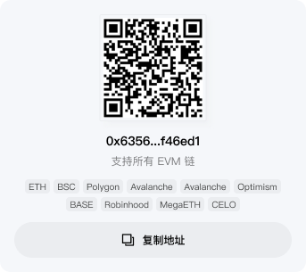
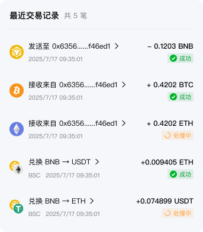

# App 端接入 Wallet Agent

本文面向移动端 / App 客户端，说明如何按 Demo（`demo-next`）的既有协议接入 Wallet Agent。
接口清单和字段级说明见 [demo-api-guide.md](demo-api-guide.md)，交易生命周期见
[mobile-integration.md](mobile-integration.md)；本文聚焦「App 怎么实现」，给出可直接照抄的调用顺序、状态处理与自测方式。

卡片视觉以设计稿为准，本文只定义**数据契约**；设计侧的卡片清单与差距跟踪见
[figma-ai-assistant-alignment.md](figma-ai-assistant-alignment.md)。

Demo 中的对照实现：

- 请求封装与错误解析：`demo-next/app/page.tsx:166`、`demo-next/lib/agent-utils.ts:24`
- 发起一轮对话：`demo-next/app/page.tsx:469`
- 消费 SSE 与断线重连：`demo-next/app/page.tsx:481`
- 事件 → UI 卡片投影：`demo-next/app/page.tsx:610`、`demo-next/lib/agent-utils.ts:268`
- 钱包上下文构造：`demo-next/lib/agent-utils.ts:248`
- 交易动作（选择报价 / 确认 / Approve / 广播 / 查询）：`demo-next/app/page.tsx:562`
- 历史管理（翻页 / 搜索 / 改名 / 置顶）：`demo-next/app/page.tsx:263`、`demo-next/lib/agent-utils.ts:613`

## 1. 安全边界

App 是唯一的签名方。以下内容绝不放进请求体、`metadata`、日志或调试面板：

- 私钥、助记词、seed phrase、xprv；
- signer / wallet client / `window.ethereum` 等对象；
- API key、secret、password 等凭据。

服务端会校验请求体：一旦在 `metadata` 等位置出现上述字段，`POST /v1/agent/turn` 直接返回
`422 {"code":"VALIDATION_ERROR"}`，请求不会下发到模型。服务端只返回**未签名交易**，并接收钱包返回的**链上交易哈希**。

## 2. 接入准备

1. 配置 API 地址（Demo 用 `NEXT_PUBLIC_AGENT_API_URL`，App 侧写入构建配置或下发配置）。
2. 启动时探测可用性：

```http
GET /health   -> {"status":"ok"}
GET /ready    -> {"status":"ready"}
```

3. 若服务端开启 `AUTH_REQUIRED`，所有请求带 `Authorization: Bearer <token>`。
   App 侧 token 由自有账号体系换取，不要硬编码在包内。
4. 为每个本地用户生成稳定的 `user_id`，并在**所有**请求中保持一致。会话归属按 `user_id` 校验，
   App 不能用别人的 `conversation_id` / `session_id`。

## 3. 每轮请求都要携带的钱包上下文

`POST /v1/agent/turn` 的字段（服务端 `extra="forbid"`，多余字段会报错）：

| 字段 | 类型 | 说明 |
| --- | --- | --- |
| `user_id` | string | 用户标识，会话归属用 |
| `message` | string | 用户自然语言输入，必填 |
| `conversation_id` | string? | 会话 ID；首轮不传，之后回传服务端返回的值 |
| `session_id` | string? | 兑换/转账 session；由服务端创建并返回，续轮原样回传 |
| `address` | string? | 当前签名钱包的公开地址 |
| `chain` | string? | 当前签名网络，如 `BASE`、`ETH`、`TRON`、`SOLANA` |
| `metadata.wallet_chain_id` | string? | 当前网络 ID，如 `0x2105`；用于网络一致性校验 |
| `supported_networks` | string[]? | App 支持查询的全部网络，最多 50 个 |
| `wallet_accounts` | {chain,address}[]? | 各网络公开地址，最多 100 条 |
| `metadata` | object | 结构化意图（可选，见下） |
| `model_id` | string? | 指定模型；必须命中服务端 `ALLOWED_MODEL_IDS`，否则 `MODEL_NOT_ALLOWED` |

`address` / `chain` 表示**当前签名钱包**；`supported_networks` / `wallet_accounts` 表示**余额查询范围**，
两者分离：用户可以在签名网络是 `ETH` 时查询全部链的资产。

多链余额上下文按下面方式构造（对应 `demo-next/lib/agent-utils.ts:248`）：

```json
{
  "user_id": "app-user-42",
  "message": "看下我的资产组合",
  "conversation_id": "conv-1",
  "address": "0x1111111111111111111111111111111111111111",
  "chain": "BASE",
  "supported_networks": ["ETH", "BSC", "BASE", "POLYGON", "ARBITRUM", "OPTIMISM", "BTC", "TRON", "SOLANA"],
  "wallet_accounts": [
    {"chain": "ETH", "address": "0x1111111111111111111111111111111111111111"},
    {"chain": "BASE", "address": "0x1111111111111111111111111111111111111111"},
    {"chain": "BTC", "address": "bc1qexampleaddress"},
    {"chain": "TRON", "address": "TExampleAddress"},
    {"chain": "SOLANA", "address": "ExampleSolanaAddress"}
  ],
  "metadata": {"wallet_chain_id": "0x2105"}
}
```

要点：

- 相同 EVM 地址也要按网络逐条列出，不要只发一条 `ETH`。
- BTC 必须提供全部收款与找零地址；`BTC` 当前只做地址余额查询，不支持 BTC 签名广播。
- 两个字段每次都发送**完整快照**；显式传 `[]` 表示清空范围，避免历史账户被继续使用。
- 缺省（不传）时按旧客户端兼容处理：单个 EVM 地址默认查询服务端支持的 EVM 网络。

`metadata` 里也可以直接下发结构化意图，跳过自然语言解析，适合 App 内已有明确入口的场景
（如余额页、Gas 页）：

```json
{"portfolio_query": {"address": "0x...", "chain": "BASE"}}
```

支持 `swap_request` / `transfer_request` / `price_request` / `transaction_query` / `portfolio_query` /
`gas_request` / `asset_query`。

## 4. 一轮对话的完整时序

```
App                                    Wallet Agent
 │  POST /v1/agent/turn                    │
 │ ──────────────────────────────────────► │  返回 {run_id, conversation_id, status:"running"}
 │                                         │  （兑换/转账会额外返回 session_id）
 │  GET /v1/agent/stream/{run_id}          │
 │ ──────────────────────────────────────► │  SSE：progress / update / response / action_required / complete
 │  ◄──── 卡片数据（报价、未签名交易等）─── │
 │                                         │
 │  本地签名 + 广播（钱包栈）               │
 │  POST /v1/swap|transfer/{session}/broadcast
 │ ──────────────────────────────────────► │  只提交 tx_hash
```

### 4.1 创建 run

```http
POST /v1/agent/turn
Content-Type: application/json

{"user_id":"app-user-42","conversation_id":"conv-1","message":"把 1 USDC 从 Base 换成 BSC 的 USDT",
 "address":"0x1111...","chain":"BASE","metadata":{"wallet_chain_id":"0x2105"}}
```

响应（HTTP 200 只代表 run 已受理，**不代表业务成功**）：

```json
{"run_id":"<run-id>","conversation_id":"conv-1","status":"running","session_id":"<swap-session>"}
```

App 必须持久化 `run_id`、`conversation_id`、`session_id`。

### 4.2 消费 SSE

```http
GET /v1/agent/stream/{run_id}
Accept: text/event-stream
```

帧格式：

```
id: 1736298045123-0
event: response
data: {"event":"response","state":{...}}
```

事件类型：

| event | 含义 | App 处理 |
| --- | --- | --- |
| `progress` | 阶段进度（含 `elapsed_ms`） | 更新 loading 文案，不视为终态 |
| `update` | 中间状态快照 | 可忽略或用于调试面板 |
| `response` | 本轮业务响应（含 `response.kind`） | 渲染卡片与助手文案 |
| `action_required` | 需要用户操作（如确认/授权） | 渲染交互卡片，**终态** |
| `complete` | 本轮结束 | 结束 loading，**终态** |
| `error` | 执行失败 | 展示 `code` / `message`，**终态** |

实现要点（对应 `demo-next/app/page.tsx:481`）：

`state` 只带 App 渲染需要的东西：Agent 的 LangChain 消息（系统提示词、
token 用量、原始工具载荷）、`request` / `wallet_context` 回显、以及服务端内部
簿记都**不下发**（此前一轮对话就有 30 KiB 是这些内容，App 侧看 log 全是噪声）。
历史记录请用 `GET /v1/agent/conversations/{id}`；流里的 `conversation_history`
只保留 `role` / `content` / `id` / `suggestions`。

卡片只出现两次：`response` 帧（本轮业务响应）与终态帧的 `state.response`。
`progress` 只用于 loading 文案（`message` / `elapsed_ms`），不再重复整张卡片
——此前同一张资产卡会被 progress / response / complete 各发一份。

- 保存每个帧的 `id` 作为游标；只有整帧解析成功后才更新游标。
- 断线**不要重新发 turn**，用游标续传：

```http
GET /v1/agent/stream/{run_id}?last_event_id=1736298045123-0
```

也可用 `Last-Event-ID` 请求头。服务端只回放游标之后的事件，因此换实例重连也不会重复处理。
- 未收到终态就断开视为异常，需要重连（Demo 最多重试 3 次，退避 250ms × 次数）。
- 收到 `RUN_NOT_FOUND` 说明 run 事件已过期（`RUN_EVENT_TTL_SECONDS`），此时应以本地保存的会话快照为准。
- 用户取消时 `AbortController.abort()` 掉流即可；服务端侧另见 4.4。

### 4.3 从事件里取卡片

`data.state` 是当前图状态快照，业务响应在 `state.response`。Demo 的归一化写法可复用：

```js
const current = payload?.state || payload?.data?.state || payload?.data || payload;
const response = current?.response?.response || current?.response || current;
```

`response.kind` 决定渲染什么卡片：

| `kind` | 关键字段 | 说明 |
| --- | --- | --- |
| `clarification` | `message`、`suggestions`、`token_candidates` | 缺参数，用同一 `conversation_id` / `session_id` 补发一轮 |
| `wallet_query` | `wallet` | 余额 |
| `portfolio_query` | `portfolio` | 资产组合（`assets`、`total_usd_value`、`complete`、`network_status`） |
| `price_query` | `symbol` 等 | 价格（附来源时间，非报价承诺） |
| `gas_check` | `gas` | Gas 估算、`sufficient`、`shortfall_raw` |
| `asset_discovery` | `assets` | 资产发现（含合约地址、精度） |
| `swap_quote` | `quotes[]` | 报价列表，必须全部展示，**不要**自动选 |
| `confirmation_required` | `confirmation` | 二次确认卡片；`confirmation.summary` 含 `recipient_address`（目标资产到账地址），批准前必须让用户核对 |
| `approval_required` | `approval_transaction` | 需要先 Approve |
| `swap_prepare` / `transfer_prepare` | `pending_transaction`、`preflight` | 待签名交易 |
| `swap_status` / `transaction_status` | `status` | 链上状态 |
| `unsupported` / `error` | `message`、`errors[]` | 兜底展示 |
| `react` | `react_results[]` | ReAct 工具调用结果，按 tool 名自行投影 |
| `react` + `receive_address` | `react_results[]` | 收款地址卡：`groups` / `supported_chains` / `message` |
| `react` + `transaction_history` | `react_results[]` | 交易记录卡：`items` / `total` / `summary` / `filter` / `partial_errors` |
| 任意 `kind` | `client_action` | App 需要弹出的界面（通讯录 / 扫码 / 金额键盘） |
| `clarification` | `suggestions[].type` / `value` | 快捷回复的类型与回填值 |

ReAct 响应（`kind: "react"`）里，业务卡片统一从 `react_results[]` 按 `tool` 名取；
`suggestions`（快捷回复）和 `client_action`（客户端动作）是**响应级字段**，不在 `react_results` 里。

**「还差一步选报价」的判定依据**（不要依赖别的字段）：`kind === "swap_quote"` 且 `quotes[]` 非空
（此时会话 `stage` 为 `selecting_quote`）。`response.stage === "quote_selection_required"` 只在
Allowance 分支出现，**不是**通用信号。

恢复历史时需要同样的投影逻辑：`GET /v1/agent/conversations/{id}` 返回 `latest_artifacts`，
字段与上表一一对应（`quotes` / `confirmation` / `approval` / `pending_transaction` / `pending_kind` /
`portfolio` / `gas` / `assets` / `status` / `broadcast_hash` / `read_only`）。

## 5. 业务流程

### 5.1 只读查询

两条路都可用，App 按场景选择：

- 自然语言：`POST /v1/agent/turn`，等待 `response`。
- 结构化 REST（不经过模型，适合钱包页直出）：

| 能力 | 接口 |
| --- | --- |
| 组合 | `GET /v1/wallet/{address}/portfolio?chain=BASE` |
| Gas | `GET /v1/wallet/{address}/gas?chain=BASE` |
| 余额 | `GET /v1/wallet/{address}/balances?chain=BASE` |
| 交易记录/手续费 | `GET /v1/wallet/{address}/transactions?chain=BASE`、`/fees?chain=BASE` |
| 资产发现 | `GET /v1/assets?chain=BASE&search=USDC` |
| 价格 | `GET /v1/prices/token?chain=ETH&symbol=ETH&decimals=18` |
| 交易状态 | `GET /v1/transactions/{chain}/{tx_hash}` |

约定：价格未知或 RPC 失败返回 `unavailable`，**不能显示成 0**；`<0.01` 的极小美元价值按 `<0.01` 展示。

### 5.2 转账

1. 发起自然语言请求，带 `address` + `chain`。
2. 等到 `response.kind === "transfer_prepare"`，展示 `preflight`（失败项、警告）和
   `pending_transaction`。
3. 校验 `pending_transaction.chain` / `chain_id` 与钱包当前网络一致；不一致先
   `wallet_switchEthereumChain`，用户拒绝则不签名。
4. 本地签名并广播，只把哈希提交回来：

```http
POST /v1/transfer/{session_id}/broadcast
{"user_id":"app-user-42","chain":"ETH","tx_hash":"0x<64 hex>"}
```

5. 重复提交同一哈希是幂等的；同一 session 提交不同哈希会被拒绝。

### 5.3 兑换

1. 发起请求（含 `provider_reference` 之前不要预设 Provider）。
2. 若为 `clarification`，用同一 `conversation_id` / `session_id` 补齐源/目标 token 合约与精度。
3. 展示全部 `quotes[]`；用户点选后提交**原样**的 `provider_reference`：

```http
POST /v1/swap/{session_id}/select-quote
{"user_id":"app-user-42","provider_reference":"bridgers-quote-123"}
```

4. 若返回 `approval_required`，展示 `approval_transaction`，本地签名广播后：

```http
POST /v1/swap/{session_id}/approve-broadcast
{"user_id":"app-user-42","chain":"BASE","approve_tx_hash":"0x<64 hex>"}
```

5. 轮询检查 Allowance（Demo 每 2s 一次，最多 60 次）：

```http
POST /v1/swap/{session_id}/continue
{"user_id":"app-user-42"}
```

`stage` 可能为 `approval_pending` / `approval_failed` / `approval_required`，只有 `swap_ready` 才能继续签名。

6. 展示 `pending_transaction`，本地签名广播后提交最终哈希：

```http
POST /v1/swap/{session_id}/broadcast
{"user_id":"app-user-42","chain":"BASE","tx_hash":"0x<64 hex>"}
```

7. 查询订单状态：`GET /v1/swap/{session_id}?user_id=app-user-42`。

### 5.4 Bitcoin（PSBT）

Bitcoin 没有 `data` calldata，也没有 chain_id；服务端返回的是**未签名交易的 PSBT**，
由 App 交给比特币签名器（本地或硬件钱包）签名后再广播。

- 转账与兑换都走同一条 `pending_transaction` 结构：

```json
{
  "chain": "BTC",
  "to": "bc1p...（收款方或 Provider 充值地址）",
  "value": "120000",
  "data": "<base64 PSBT>",
  "display": {
    "action": "native_transfer | provider_deposit",
    "format": "psbt",
    "from": "bc1q...（找零回填的主地址）",
    "from_addresses": "bc1q...,bc1p...,3FGA...（App 声明的全部 BTC 地址）",
    "amount_raw": "120000",
    "fee_raw": "459",
    "change_raw": "79541",
    "unsigned_tx_hex": "0200000001...",
    "deposit_address": "bc1p...（仅兑换）",
    "provider_order_id": "...（仅兑换）"
  }
}
```

- 判定方式：`chain === "BTC"` 且 `display.format === "psbt"`；此时 `data` 是 base64
  PSBT，**不要**按十六进制 calldata 解析。`value` 是聪（satoshi）为单位的整数。
- **UTXO 聚合**：服务端会把 App 为该钱包声明的**所有** BTC 地址（收款地址与找零地址）
  的 UTXO 合并挑选，因此单笔转账不再受某一个地址余额限制；找零回到主地址
  （`display.from`）。`display.from_addresses` 是参与挑选的地址清单（逗号分隔），
  `display.input_count` 是实际花费的 UTXO 数。App 需要提供**完整**的地址列表，
  否则大额转账仍可能报 `insufficient Bitcoin balance`。
- 广播：用 PSBT 签名得到完整交易后向比特币网络广播（例如 Esplora
  `POST /api/tx`），再把交易哈希回传：

```http
POST /v1/transfer/{session_id}/broadcast
{"user_id":"app-user-42","chain":"BTC","tx_hash":"<64 hex>"}
```

服务端接受 64 位十六进制（大小写均可）的 BTC 交易哈希，并会用 Esplora
`/tx/{hash}/status` 观察上链情况：已确认返回 `confirmed`，已进入内存池返回
`broadcast_pending`，观察不到返回 `unknown`。兑换回传走
`/v1/swap/{session_id}/broadcast`，语义相同。

- **App 需要提供的签名材料**：BIP174 签名器要求每个输入带上原 UTXO 之外的信息，
  App 在上报 `wallet_accounts` 时按地址补充这三项（都是公开数据，服务端只用于组装
  PSBT，不参与签名）：

```json
{
  "chain": "BTC",
  "address": "3FGA…",
  "pubkey": "02ab…（33 字节压缩公钥；p2tr 传 32 字节 x-only）",
  "derivation_path": "49'/0'/0'/0/0",
  "master_fingerprint": "a1b2c3d4"
}
```

  - BIP49（`3…`）**必须**提供 `pubkey`，否则 PSBT 里没有 redeem script，标准签名器
    与硬件钱包都无法签；提供后该输入改用 witness UTXO，不再依赖上一笔交易 hex。
  - 提供 `pubkey` 还让服务端能在 PSBT 中写入 `PSBT_IN_BIP32_DERIVATION` 与找零输出的
    `PSBT_OUT_BIP32_DERIVATION`（硬件钱包签名的前提）。
  - 服务端会校验 `pubkey` 确实控制该地址，不匹配时**静默丢弃**该地址的签名材料并退回
    原有行为，因此填错不会生成错误 PSBT，只会签不出来。
  - 只填地址（不带签名材料）仍然可用，只是 BIP49 地址无法签出有效交易。

- **UTXO 与费率策略**（服务端配置，App 无需感知）：默认只花费节点报告为已确认的
  UTXO（`BTC_MIN_CONFIRMATIONS=1`，设 0 才允许花未确认的）；费率默认取 mempool 6 区块
  目标（`BTC_FEE_TARGET_BLOCKS`），也可用 `BTC_FEE_RATE_SAT_VB` 固定费率；默认
  **不**开启 RBF（`BTC_RBF_ENABLED=true` 时输入使用 `nSequence=0xfffffffd`，交易可加价，
  此时 PSBT 的 `display.rbf` 为 `"true"`）。

- 兑换：`display.deposit_address` 是 Provider 的充值地址，`to` 与之一致；签名广播后同样用
- 兑换（BTC 实测注意）：Provider 返回的是 `txData.toAddress`（EVM 才是 `txData.to`），
  服务端已兼容两者；若响应里还有 `memo`，会原样出现在 `display.memo` 里。充值地址是
  "一单一地址"，所以**不强制** App 提供 `refund_address`，保持可选透传。
- 兑换的 `recipient_address` 必须是**目标链**上的地址：BTC → USDT(ETH) 要填 `0x…` 收款地址。
  填成源链地址时 Provider 不会报价而是直接拒绝（Bridgers 实测 `resCode 103 / invalid address`），
  服务端归一化成 `PROVIDER_PREPARE_FAILED`（`details.provider_code = "103"`）；App 应提示用户
  检查收款地址，不要当成可重试的服务故障。BTC 兑换的 `pending_transaction` 与转账同形：
  `display.format = "psbt"`，另有 `input_count` / `fee_raw` / `change_raw` / `unsigned_tx_hex`。
- 实测还发现 Bridgers 对**中国大陆出口 IP** 返回 `resCode 1114`（不在服务地区），
  因此部署出口必须在境外（测试服 us-east-1 正常）；App 侧遇到该错误应提示用户，不要当成参数错误。
  `/v1/swap/{session_id}/broadcast` 回传哈希，再按 Provider 订单轮询状态。
- 服务端只在本地根据 UTXO 组装 PSBT（含手续费与找零），**不持有私钥、不签名、不广播**。
- 浏览器插件若暂时没有 BTC 签名 API，可先把 PSBT（`data`）或 `display.unsigned_tx_hex`
  导出给外部钱包完成签名。

### 5.5 取消与失效

- 取消当前兑换：`POST /v1/swap/{session_id}/cancel`（`{"user_id":"..."}`）。
- `confirmation` 有 `requested_at` / `expires_at`；超时后服务端返回 `CONFIRMATION_EXPIRED`，需重新发起。
- 确认卡片带 `task_id` / `task_revision` / `payload_hash`。用户改了币种、网络或数量后，
  **旧报价、旧确认、旧未签名交易一律作废**，必须重新走一轮。
- 广播失败后不要伪造成功状态；只提交真实哈希。

### 5.6 对话卡片字段契约

下面每个字段都是 App 渲染对应卡片需要的全部输入。服务端只给数据，不生成 UI。

设计稿对照（视觉参数以 Figma 为准，这里只给跳转锚点；节点 ID 会随设计文件重新导出而变，
失效时到 [figma-ai-assistant-alignment.md](figma-ai-assistant-alignment.md) 找最新对照。
节点编号就是可点链接，点开直接定位到 Figma 里那一屏）：

| 卡片 | Figma 节点 |
| --- | --- |
| 空态 + 快捷胶囊行 | [`33715:148396`](https://www.figma.com/design/2N2sTwtjY3OznWq8m9zpmR/Cat-Wallet-v1.6.0?node-id=33715-148396) |
| 用户消息气泡 | [`33715:146536`](https://www.figma.com/design/2N2sTwtjY3OznWq8m9zpmR/Cat-Wallet-v1.6.0?node-id=33715-146536) |
| 交易记录卡 | [`33715:146539`](https://www.figma.com/design/2N2sTwtjY3OznWq8m9zpmR/Cat-Wallet-v1.6.0?node-id=33715-146539)（屏 [`33715:146533`](https://www.figma.com/design/2N2sTwtjY3OznWq8m9zpmR/Cat-Wallet-v1.6.0?node-id=33715-146533)） |
| 收款地址卡 / 支持链卡 | [`33715:146203`](https://www.figma.com/design/2N2sTwtjY3OznWq8m9zpmR/Cat-Wallet-v1.6.0?node-id=33715-146203) / 收款地址屏内 |
| 多链资产总览卡 | 见对齐文档第四节（节点待补） |
| 转账：地址输入 / 金额输入 | [`33692:37951`](https://www.figma.com/design/2N2sTwtjY3OznWq8m9zpmR/Cat-Wallet-v1.6.0?node-id=33692-37951) / [`33692:37984`](https://www.figma.com/design/2N2sTwtjY3OznWq8m9zpmR/Cat-Wallet-v1.6.0?node-id=33692-37984) |
| 转账：链选择 / 风险提示 | [`33692:48836`](https://www.figma.com/design/2N2sTwtjY3OznWq8m9zpmR/Cat-Wallet-v1.6.0?node-id=33692-48836) / [`33692:48838`](https://www.figma.com/design/2N2sTwtjY3OznWq8m9zpmR/Cat-Wallet-v1.6.0?node-id=33692-48838) |
| 交易状态页（App 页，非对话卡） | 分区 [`33617:39513`](https://www.figma.com/design/2N2sTwtjY3OznWq8m9zpmR/Cat-Wallet-v1.6.0?node-id=33617-39513) |

文件：`Cat Wallet v1.6.0`，fileKey `2N2sTwtjY3OznWq8m9zpmR`，画布 `32786:19122`（v1.6.9 AI 助手）。

#### 视觉参考（直接导出的节点截图）

截图从 Figma 节点导出、与上表一一对应，方便离线对照和在评审里引用；
**设计稿始终是最新来源**，改版后按同样的节点重新导出即可（文件名带版本号，过期一眼可见）。

| 收款地址卡 | 交易记录卡 |
| --- | --- |
|  |  |

其余卡片（资产总览、转账参数、风险提示）目前只有节点链接——需要的话按同样方式补图。

**快捷回复** `response.suggestions[]`（`kind == "clarification"`）

| 字段 | 说明 |
| --- | --- |
| `label` | 胶囊文案 |
| `message` | 点击后作为用户消息回传的内容 |
| `type` | `chain` / `symbol` / `amount` / `address` / `token` / `action` |
| `value` | 回填值；`action` 类型时是动作名（见下） |
| `data` | 槽位数据，建议随下一轮请求原样放进 `metadata.suggestion_data` |

- `type: "action"` 的胶囊是**动作**不是槽位值，不要当参数提交。
- `type: "amount"` 的 `value` 可能是 `25%` 这种比例，需要 App 用当前余额换算出具体数量再提交。

**客户端动作** `response.client_action`

```json
{"type": "open_contacts", "reason": "用户要给朋友转账", "slots": {"chain": "BTC"}}
```

- `type` 取 `open_contacts` / `scan_qr` / `open_amount_keypad` / `address_input`，
  App 收到后弹出自己的界面（`address_input` 弹地址输入框让用户粘贴收款地址）。
- 用户选完，把结果作为**下一轮** `turn` 的输入回传（地址文本，或 `metadata.suggestion_data`）。
- 服务端只会下发白名单内的动作；工具遇到其它取值返回 `CLIENT_ACTION_UNSUPPORTED`，不会误导 App 弹窗。

**收款地址卡** `react_results` 中 `tool == "receive_address"` 的 `result`

| 字段 | 说明 |
| --- | --- |
| `groups[]` | `{group, label, address, addresses[], chains[]}`；所有 EVM 网络合并为一组，BTC/TRON 各自成组 |
| `supported_chains[]` | 全部可用链，用于「支持的链」卡片 |
| `message` | 可直接展示的话术，与设计稿一致 |

二维码由 App 用 `groups[].address` 自行生成；`addresses[]` 多于一个时（BTC 收款+找零地址）要在卡片上说明。

**交易记录卡** `react_results` 中 `tool == "transaction_history"` 的 `result`

| 字段 | 说明 |
| --- | --- |
| `items[]` | `chain`、`tx_hash`、`status`、`direction`、`symbol`、`decimals`、`amount_raw`、`raw_only`、`counterparty`、`occurred_at`、`failure_reason` |
| `total` / `fetched` | 本页条数 / 本轮实际抓到的总条数（`fetched` 用于「拉取到 N 笔中的最近 M 笔」） |
| `summary` | 形如「7 笔转出、3 笔入账」，按抓到的全部记录统计 |
| `filter` | 回显本次的 `chain` / `direction` |
| `partial_errors[]` | 本轮没能读取的链，形如 `BSC:timeout` |

- `direction`：`send` / `receive` / `swap` / `unknown`；符号（`+` / `-`）由 App 决定。
- `raw_only: true` 表示来源**没有给出小数位**，`amount_raw` 是代币最小单位，**不要做除法换算**，原样标注即可。
- `partial_errors` 非空**不能渲染成「没有交易」**，要在卡片上写清楚哪条链本轮没读到。
- 「只看支出」= 下一轮传 `direction: "send"`。

**资产卡** `portfolio`（`kind == "portfolio_query"` 或 `react_results` 中的 `portfolio_snapshot`）

- `assets[]`：`asset`（含 `symbol`/`chain`）、`amount`、`amount_raw`、`usd_value`、`unit_price`、`addresses[]`。`unit_price` 可能为 `null`（价格未知）。
- `total_usd_value`、`has_assets`（为 `false` 时渲染 `$ 0.00` +「暂无资产数据」）、`complete`、`valuation_complete`、`network_status[]`。
- 查询不完整时（`complete == false`）必须保留「未查询 ≠ 余额为零」的说明。

**风险提示** `preflight.risk`

```json
{"level": "warning", "code": "SELF_TRANSFER", "message": "..."}
```

- `level: "danger"` 时 `preflight.ok == false`，交易被阻断，App 不要给出签名入口。
- `level: "warning"` 不阻断，展示后允许继续。
- 同样的信息也在 `preflight.checks[]` 里（`name == "address_risk"`）。

**交易状态** `transaction_status`

- `status`（`pending` / `confirmed` / `failed` / `dropped` / `unknown`）、`chain`、`tx_hash`、`message`。
- `failure_reason`：失败原因；`reason_unavailable: true` 表示**来源没有提供原因**，此时按「无法获知原因」表述，不要编造。

**从交易详情页进入对话**：把当前交易放进 `metadata.transaction_query`：

```json
{"transaction_query": {"chain": "ETH", "tx_hash": "0x..."}}
```

这样「解释失败原因？」「为什么还没到账？」这类默认问题不需要用户重复粘贴哈希，服务端会直接查这笔。

## 6. 签名与广播（App 职责）

- 未签名交易包含 `chain`、`chain_id`、`to`、`data`、`value`；Bitcoin（`display.format == "psbt"`）的 `data` 是 base64 PSBT，`chain_id` 为空。
- 签名前必须向用户展示资产、数量、收款方 / spender，并做一次明确确认。
- `pending_transaction` 的 `chain` / `chain_id` 必须与钱包当前网络一致，否则先切网。
- 服务端**不会**替 App 签名、选 Provider 或自动广播。

## 7. 会话与历史

### 7.1 接口

| 操作 | 接口 |
| --- | --- |
| 列表 | `GET /v1/agent/conversations?user_id=...&limit=50&cursor=...&q=...` |
| 详情 | `GET /v1/agent/conversations/{id}?user_id=...` |
| 改名 / 置顶 | `PATCH /v1/agent/conversations/{id}?user_id=...` |
| 删除 | `DELETE /v1/agent/conversations/{id}?user_id=...` |

列表返回（`next_cursor` 为 `null` 表示没有更多）：

```json
{
  "conversations": [
    {
      "conversation_id": "07f23a20-...",
      "session_id": "2d6166a0-...",
      "title": "我最近有哪些交易？",
      "pinned": false,
      "status": "created",
      "stage": null,
      "created_at": "2026-10-10T09:27:18Z",
      "updated_at": "2026-10-10T09:27:32Z",
      "summary": "Wallet Agent 对话"
    }
  ],
  "next_cursor": "2026-10-10T09:27:32.800559Z"
}
```

- **标题** `title`：首条用户消息（空白折叠、超过 40 字截断加省略号），兑换会话回退成
  「BNB → ETH」；`summary` 是旧字段，仅为兼容保留，**新实现请用 `title`**。
- **分页**：按 `updated_at` 倒序，`limit` 上限 100。把上一页的 `next_cursor` 原样回传即可翻页，
  直到返回 `null`。
- **搜索** `q`：按标题做大小写不敏感的子串匹配；分页与搜索可以同时使用。
- **置顶** `pinned`：服务端只回标记，**排序仍按 `updated_at`**（保证翻页稳定），
  置顶项的最终展示位置由 App 决定，不要把置顶当成服务端排序。
- **改名 / 置顶**：`PATCH` 请求体 `{"title": "...", "pinned": true}`，只传要改的字段；
  两个都没传返回 `422`，会话不存在返回 `404`。

### 7.2 恢复对话

详情返回 `messages`（含 `artifacts` 卡片快照，服务端在 SSE 中已剥离该字段以去重）、
`latest_artifacts`、`model_trace`、`session_id`。App 冷启动时应据此恢复消息列表和当前卡片，
而不是依赖 SSE 重放。投影规则与 §4.3 完全一致，**两处必须共用同一份实现**。

**卡片是逐条恢复的**：每条助手消息都带自己的 `artifacts`，恢复时要为每条消息各渲染一次卡片，
而不是只渲染最后一条。`latest_artifacts` 只是"当前会话最后一张卡片"的便捷入口，用于
`messages` 里没有快照的老数据兜底。

三条硬约束：

1. **`artifacts` 是当时的快照，不是按新逻辑重算的。** 因此渲染逻辑变更后，老会话里存的仍是旧形状——
   这正是要求"实时渲染与历史恢复共用同一份投影函数"的原因，否则两处会漂移。
2. **只有最后一条助手消息的卡片可交互。** 历史卡片一律只读（不给按钮），避免用户回头去点一张
   早已失效的卡片。Demo 的实现见 `demo-next/app/page.tsx:883`（`index === lastAssistantIndex`）。
3. **无法识别形状的 `artifacts` 会被丢弃。** 投影函数遇到不认识的响应（例如只带 `route` 的纯文字回答）
   应当返回"无卡片"，并保留文字消息，不要报错也不要编造卡片。

4. **恢复出的待签名交易卡必须降级为只读。** 如果最后一条助手消息是
   `transfer_prepare` / `swap_prepare`（`pending_transaction`），它在恢复后不应再提供签名入口——
   服务端无法判断这笔未签名交易是否仍然有效（nonce、gas、报价有效期都可能已经变了）。
   App 应当只展示这笔交易的详情，并要求用户重新发起；需要继续时按 §5.2 / §5.3 重新走一遍准备流程。

   > Demo 目前**没有**做这个降级（刷新后仍可点「签名并广播」），仅作为"能恢复出卡片"的演示，
   > 不是可照抄的安全实现。App 不要沿用这个行为。

### 7.3 参考实现（Demo）

历史面板是照着这套契约写的，App 可以直接对照 `demo-next/app/page.tsx:861`。三个纯函数
（`demo-next/lib/agent-utils.ts:613`）就是客户端要做的那点事，也有单测覆盖：

```ts
// 1) 拼查询串：空搜索不要发 q，空 cursor 不要发 cursor
buildHistoryPath({ userId, query, cursor, limit: 20 })
// → /v1/agent/conversations?user_id=u1&limit=20&q=流水&cursor=2026-10-10T06:15:51Z

// 2) 追加一页：按 conversation_id 去重，返回下一页游标
const { conversations, nextCursor } = mergeHistoryPage(existing, page);

// 3) 本地排序：置顶优先，其余按 updated_at 倒序（服务端顺序用于翻页，不要改动它）
setRows(sortHistoryRows(conversations));
```

调用约定：

| 动作 | 请求 | 说明 |
| --- | --- | --- |
| 首次打开 / 重新加载 | `buildHistoryPath({userId, query})` | 不传 `cursor`，`next_cursor` 置空重来 |
| 加载更多 | `buildHistoryPath({userId, query, cursor: nextCursor})` | 用当前 `next_cursor`，结果**追加**而不是替换 |
| 搜索 | 同上但带 `query` | 搜索和翻页可叠加：搜索后翻页要一直带着同一个 `q` |
| 改名 | `PATCH {"title"}` | 成功后可直接用返回的 `conversation` 覆盖该行 |
| 置顶 | `PATCH {"pinned"}` | 只改本地顺序，**不要重排服务端页** |
| 删除 | `DELETE` | 需二次确认：服务端是物理删除 |

**三个容易踩的点**：① 追加页时不去重会出现重复行；② 把服务端返回的页重新排序会破坏游标语义；
③ 置顶当成分页条件会导致刷新后置顶项消失（服务端不按 `pinned` 排序）。

### 7.4 已知限制与注意事项

- **归属**：`user_id`（或 Bearer token）决定归属；用别人的 `conversation_id` 返回 **404**
  而不是 403，这是刻意的——不要据此判断"会话是否存在"。
- **删除是物理删除**：会话记录会和 LangGraph checkpoint 一起删除，**不可恢复**，
  App 侧必须二次确认。
- **按 id 操作有 100 条上限**：详情、改名、删除都是在"该用户最近 100 条会话"里查找，
  超出范围的旧会话用列表分页能读到，但按 id 操作会返回 404。当前实现如此，
  App 若要支持长期会话管理，需要服务端补一个按 `thread_id` 直查的路径。
- **空会话**：只创建未产生回复的会话也可能出现在列表里（`status == "created"`），
  是否展示由 App 决定。
## 8. 错误处理

REST 错误统一信封：

```json
{"code":"VALIDATION_ERROR","message":"..."}
```

| code | 场景 | App 处理 |
| --- | --- | --- |
| `VALIDATION_ERROR` | 字段缺失 / 非法 / 携带签名材料 | 修正请求，不要重试 |
| `MODEL_NOT_ALLOWED` | `model_id` 不在白名单 | 回落到默认模型 |
| `INVALID_AGENT_TEST_INTENT` | 测试意图非法 | 仅联调用 |
| `CONFIRMATION_EXPIRED` / `CONFIRMATION_NOT_PENDING` | 确认已过期或不存在 | 重新发起业务 |
| `CONFIRMATION_RESUME_NOOP` | 重复恢复确认 | 忽略 |
| `PROVIDER_REGISTRATION_FAILED` | 广播哈希登记失败 | 可重试同一哈希 |
| `INVALID_TRANSACTION_HASH` | 哈希格式错误 | 修正后重试 |
| `OKX_CAPABILITY_UNAVAILABLE` / `PRICE_PROVIDER_UNAVAILABLE` | 上游不可用 | 降级展示，稍后重试 |
| `RUN_NOT_FOUND` | run 事件过期 | 用本地会话快照恢复 |

SSE 的 `error` 事件正文同样是 `code` + `message`。

## 9. 实现清单

- 一个用户操作 = 一个 `turn`；补参数复用 `conversation_id` / `session_id`，不要新建会话。
- 每次 `turn` 独立维护进度时间线，不要把上一轮的进度混进来。
- SSE 必须处理终态与重连，`HTTP 200` 不能当作成功判据。
- 卡片渲染与历史恢复共用同一套投影函数，避免两处逻辑漂移。
- 历史列表：翻页只用 `next_cursor`、结果按 `conversation_id` 去重后追加；不要重排服务端返回的页。
- 历史列表：`pinned` 只影响本地展示顺序；搜索与翻页要带上同一个 `q`。
- 未签名交易只在 App 侧签名，提交的永远只是哈希。
- 余额、价格、Gas 的未知值一律显示为「未知 / 不可用」，不能当成 0。
- `partial_errors` 非空的查询结果要标注「部分链未读取」，不能当成「没有数据」。
- `raw_only: true` 的交易记录金额不要做小数位换算。
- `client_action` 必须由 App 处理（弹通讯录/扫码/键盘），不要当普通文本塞回模型。
- 从交易详情页进入时带上 `metadata.transaction_query`，默认问题才能落到具体那笔交易。

## 10. 自测

冒烟脚本（仓库自带）：

```bash
python scripts/smoke_test.py --base-url http://<server-ip>:8000 --message "你好"
```

手工核对一轮对话：

```bash
# 1) 建 run
curl -sS -X POST http://<server-ip>:8000/v1/agent/turn \
  -H 'Content-Type: application/json' \
  -d '{"user_id":"smoke-user","message":"ETH 的价格多少"}'

# 2) 读 SSE（把 <run-id> 换成上一步返回值）
curl -N http://<server-ip>:8000/v1/agent/stream/<run-id>

# 3) 断线重连（把 <event-id> 换成最后一帧的 id）
curl -N 'http://<server-ip>:8000/v1/agent/stream/<run-id>?last_event_id=<event-id>'
```

真机联调清单：

- 冷启动 → `/health`、`/ready` 通过后 UI 才允许发送。
- 首轮不传 `conversation_id`，后续轮次正确回传。
- 余额查询覆盖多链；未提供地址的网络显示「未提供地址」而不是 0。
- 兑换走完 报价 → 选择 → （Approve）→ 广播 → 状态 全流程。
- 杀进程/断网后重连：不重复发 turn、不重复广播，状态能恢复到正确阶段。
- 未签名交易的网络与钱包当前网络不一致时，签名入口被正确拦截。

## 11. 联调与调试方案

目标：App 和服务器之间出问题时，**一眼看出是输入没带、路由走错、还是外部数据源慢/失败**，
而不是靠猜和反复重试。

### 11.1 App 调试面板建议展示的内容

服务端已经在响应里给了这些字段，App 调试模式直接平铺即可（Demo 的「后端调试数据」面板就是这套）：

| 字段 | 用途 |
| --- | --- |
| `run_id` / `conversation_id` / `session_id` | 和服务器日志、checkpoint、会话记录对齐 |
| `response.route` | `graph_role` / `route_mode` / `route_reason`：判断这轮走了 ReAct 还是确定性链路 |
| `react_results[]` | 每个工具的原始返回，按 `tool` 折叠 |
| `react_tool_timings[]` | 每个工具的耗时、`status`、`error_code`、`cache_status` |
| `model_trace[]` | 用了哪个模型、耗时、token 数 |
| `preflight.checks[]` / `preflight.risk` | 预检查逐项结果与风险等级 |
| `client_action` / `suggestions` | 需要 App 侧响应的动作与快捷回复 |
| 原始 SSE 帧 | 归一化投影会吃掉字段，调试时保留一份原文 |

建议再加一个「显示原始响应」开关，直接看未投影的 `state.response`——卡片渲染有问题时，
这一步能立刻区分「服务端没给」还是「App 投影丢了」。

### 11.2 服务端已有的调试入口

- `GET /debug/metrics`：进程内的模型/工具调用计数与缓存命中统计，用于判断「是模型慢还是工具慢」。
- `GET /v1/agent/conversations/{id}`：拿到完整的 `messages`、`latest_artifacts`、`model_trace`，
  可复现某一轮的卡片快照，不必回放 SSE。
- 每轮 SSE 都带 `run_id`，断线后可用 `Last-Event-ID` 续传，不要重新发一轮。

### 11.3 一键诊断包（建议 App 实现）

在调试面板加一个「复制诊断信息」按钮，内容包含：

1. 本轮 `request`（**去除 token / 助记词 / 私钥**）
2. `run_id`、`conversation_id`、`session_id`
3. `response.route` + `response.kind` + `message`
4. `react_tool_timings[]`（含 `error_code`）
5. `partial_errors`（如果有）
6. 原始 SSE 尾部若干帧

安全边界：服务端本身不持有私钥/助记词/签名结果，诊断包里也不应该出现它们；
`user_id` 用测试账号，Bearer token 不要写进诊断包。

### 11.4 失败自查表

| 现象 | 先看什么 |
| --- | --- |
| 卡片没有数据 | `partial_errors` 是否非空（外部链慢/失败）；`react_tool_timings` 里该工具的 `error_code` |
| 一直反问地址/金额 | 请求是否带了 `wallet_accounts`、`supported_networks`；`suggestions` 是否被 App 丢弃 |
| 金额数字明显不对 | 记录里 `raw_only` 是否为 `true`（没有小数位，不能换算） |
| 「无法确定交易状态」 | 是否传了 `metadata.transaction_query`；哈希与链是否匹配 |
| 交易准备不出来 | `preflight.checks[]` 里哪一项 `failed`（`address_risk` 的 `danger` 会直接阻断） |
| 回答和上一轮对不上 | 补参数时是否复用了同一个 `conversation_id` / `session_id` |

### 11.5 联调顺序建议

1. **上下文与 SSE**：先用只会返回 `clarification` 的输入（不触发任何链上请求），
   验证 `wallet_accounts` 透传、`conversation_id` 复用、断线续传。
2. **只读**：资产、价格、交易记录各跑一轮，确认 `partial_errors`、`raw_only` 等诚实字段被正确展示。
3. **待签名交易**：转账/兑换到 `pending_transaction`，确认预检查与风险提示，**不广播**。
4. **回执**：用一条已上链的哈希验证 `transaction_status` 与 `failure_reason`。
5. **客户端动作**：验证通讯录/扫码/键盘的回填闭环。

每步都用同一个测试账号，方便用 `GET /v1/agent/conversations` 回看整条链路。
